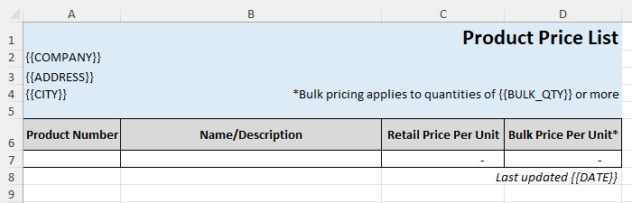
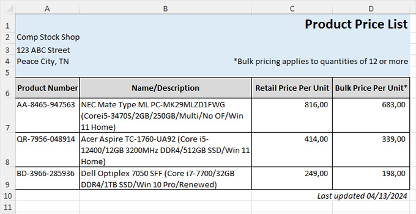
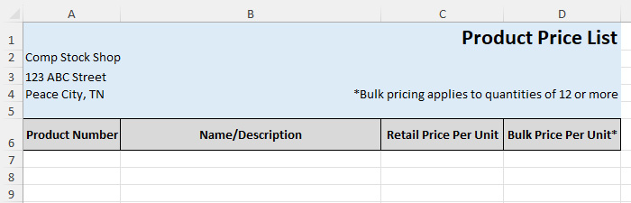
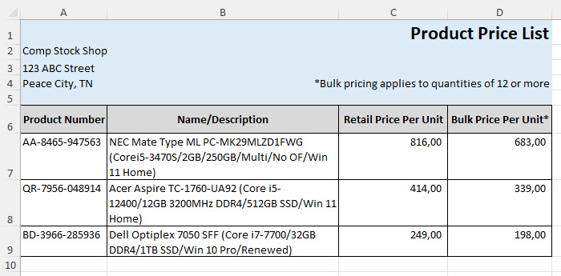
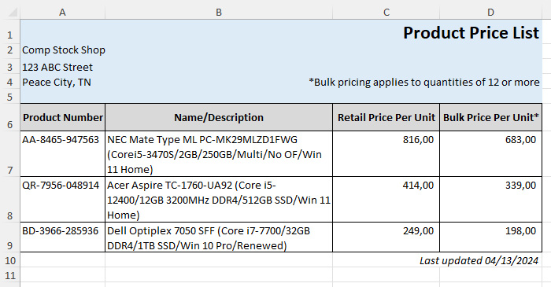

# FastExcelTemplator

<!-- NOTE for maintainers: the README and CHANGELOG exist in two languages.
     When editing README.md / CHANGELOG.md, update the Russian counterparts
     README.ru.md / CHANGELOG.ru.md accordingly.
     docs/*.md (API Reference) are auto-generated by autodoc.php — do not edit by hand. -->

🇬🇧 English · [🇷🇺 Русский](README.ru.md)

**FastExcelTemplator** is a part of the **FastExcelPhp Project** which consists of

* [FastExcelWriter](https://packagist.org/packages/avadim/fast-excel-writer) - to create Excel spreadsheets
* [FastExcelReader](https://packagist.org/packages/avadim/fast-excel-reader) - to read Excel spreadsheets
* [FastExcelTemplator](https://packagist.org/packages/avadim/fast-excel-templator) - to generate Excel spreadsheets from XLSX templates
* [FastExcelLaravel](https://packagist.org/packages/avadim/fast-excel-laravel) - special **Laravel** edition

## Introduction

**FastExcelTemplator** can generate Excel-compatible spreadsheets in XLSX format (Office 2007+) from XLSX templates,
very quickly and with minimal memory usage. This library is designed to be lightweight, super-fast and requires minimal memory usage.

**Features**

* Supports XLSX format only (Office 2007+) with multiple worksheets
* Transfers from templates to target spreadsheets styles, images, notes
* Replaces the entire cell values and substrings
* You can use any row from a template as row template to insert and replace a row with new values
* The library can read styling options of cells - formatting patterns, colors, borders, fonts, etc.

## Which library do I need?

"Working with Excel in PHP" is really three different tasks, each with its own tool in the FastExcelPhp family:

| Your task | Use |
|---|---|
| Read data from an existing file | [FastExcelReader](https://github.com/aVadim483/fast-excel-reader) |
| Build a spreadsheet from scratch in code | [FastExcelWriter](https://github.com/aVadim483/fast-excel-writer) |
| Fill a ready-made XLSX form with data | **FastExcelTemplator** (this library) |

Reach for **FastExcelTemplator** when you already have a designed XLSX document (an invoice, act, contract, report) and only need to put data into it — keeping the logo, borders, number formats and formulas that are already in the file. If you catch yourself re-creating in code the formatting that already exists in a file, you want the template approach.

## Installation

Use `composer` to install **FastExcelTemplator** into your project:

```
composer require avadim/fast-excel-templator
```

### Requirements

* PHP >= 7.4 with the `zip`, `json`, `mbstring`, `xmlreader` and `dom` extensions.
* Composer pulls the sibling packages automatically. The current 3.x line depends on:

  | Package | Constraint |
  |---|---|
  | `avadim/fast-excel-reader` | `^4.4` |
  | `avadim/fast-excel-writer` | `^6.16.1` |

  `avadim/fast-excel-helper` is installed transitively through these packages.

## How it works

Understanding the design explains both what the library does effortlessly and where its limits are.

* **Streaming.** Sheet data is read and written one row at a time, without loading the entire sheet into memory. Memory usage also depends on styles, metadata and the number of captured row templates.
* **The output is assembled from your template.** The library replaces sheet data and retains original archive parts and metadata, including images, notes, conditional formatting and validation rules. Metadata ranges are not automatically remapped when rows are inserted or removed; see the [XLSX support matrix](XLSX_SUPPORT.md).
* **Forward-only output.** A row cannot be changed after it has been written. Template capture and metadata preservation use separate reads of the template without loading the entire sheet.
* **Formulas are transferred, not evaluated.** The library writes the formula text and does not compute its result — Excel does that when the file is opened. When a captured row template is re-inserted at another row, its formulas are re-based automatically (A1 references shift to the target row), so a `=C7*D7` in the template row becomes `=C8*D8`, `=C9*D9`, and so on.

## Templates Usage

Example of template



From this template you can get a file like this



**Step 1** - open template and set replacements
```php
// Open template and set output file
use avadim\FastExcelTemplator\Excel;

$excel = Excel::template($tpl, $out);
// Get the first sheet
$sheet = $excel->sheet();

$fillData = [
    '{{COMPANY}}' => 'Comp Stock Shop',
    '{{ADDRESS}}' => '123 ABC Street',
    '{{CITY}}' => 'Peace City, TN',
];

// Set replacements of entire cell values for the sheet
// If the value is '{{COMPANY}}', then this value will be replaced,
// but if the value 'Company Name {{COMPANY}}', then this value will not be replaced 
$sheet->fill($fillData);

// Set replacements of any occurring substrings
// If the value is '{{DATE}}' or 'Date: {{DATE}}', then substring '{{DATE}}' will be replaced,
$replaceData = ['{{BULK_QTY}}' => 12, '{{DATE}}' => date('m/d/Y')];
$sheet->replace($replaceData);
```

**`fill()` vs `replace()`** — the most common gotcha:

* `fill()` replaces the value **only if the whole cell equals the key**. A cell containing `{{COMPANY}}` is replaced; a cell containing `Company Name {{COMPANY}}` is **not**.
* `replace()` replaces the key as a **substring**, anywhere inside the cell text.

Both maps apply to every cell the library writes to the output — transferred rows and inserted rows alike.
**Step 2** - transfer the top of the sheet and the table headers from the template to the output file
```php
// Transfer rows 1-6 from templates to output file
$sheet->transferRowsUntil(6);
```
There are 6 rows read from template, the output file also contains 6 lines



**Step 3** - insert inner table rows
```php
// Get the row number 7 as a template and go to the next row in the template
$rowTemplate = $sheet->getRowTemplate(7);

// Fill row template and insert it into the output
foreach ($allData as $record) {
    $rowData = [
        // In the column A wil be written value from field 'number'
        'A' => $record['number'],
        // In the column B wil be written value from field 'description'
        'B' => $record['description'],
        // And so on...
        'C' => $record['price1'],
        'D' => $record['price2'],
    ];
    $sheet->insertRow($rowTemplate, $rowData);
}
```
We filled in and inserted rows 7, 8 and 9



**Step 4** - Now transfer the remaining rows and save file

```php
// Method transferRows() without arguments transfers remaining rows from the template to the output file 
$sheet->transferRows();

// ...
// Save new file
$excel->save();
```




You can find code examples in */demo* folder

## Modification of Spreadsheets

Use the ```rows()``` method to read rows, modify them using callback, and write them to the output file.

```php
use avadim\FastExcelTemplator\Excel;

$excel = Excel::template($tpl, $out);
$sheet = $excel->sheet();

$sheet->rows(function ($sourceRowNum, $targetRowNum, $rowData) {
    // $rowData is an instance of the RowTemplate

    // skip the first row
    if ($sourceRowNum === 1) {
        return null;
    }
    // $rowData
    // if a value of cell 'A' then break
    if ($rowData->getValue('A') > 5) {
        return false;
    }
    // write value to cell 'B'; if the cell 'B' does not exist, it will be created
    $rowData->setValue('B', $rowData->getValue('A') * 2);
    // return modified row
    return $rowData;
});
$excel->save();
```
You can add one or more cells to the end of a row in the callback function.
The styles and value from the source cell will be copied to the new cell.
If you do not explicitly specify a source cell, the last cell in the row will be used as the source.

```php
$sheet->rows(function ($sourceRowNum, $targetRowNum, $rowData) {
    // Clone the last cell of the row and add them to the end of the row and assign it the value 123
    $rowData->appendCell()->withValue(123);

    return $rowData;
});

$sheet->rows(function ($sourceRowNum, $targetRowNum, $rowData) {
    // Clone the cell 'B' and add them to the end
    $rowData->appendCell('B');

    // Clone the last cell three times
    $rowData->appendCell(null, 3)->withValues([111, 222, 333]);

    return $rowData;
});
```

Also, you can clone any cell (with styles and value) to other cell

```php
$sheet->rows(function ($sourceRowNum, $targetRowNum, $rowData) {
    // Clone the cell 'A' to the cell 'E' and assign it the SUM()
    $rowData->cloneCell('A', 'E')
        ->withValues(['=SUM(A' . $targetRowNum . ':E' . $targetRowNum . ')']);

    return $rowData;
});
```

If you need to remove cells, use the ```removeCells()```.

```php
$sheet->rows(function ($sourceRowNum, $targetRowNum, $rowData) {
    // Remove cells B and D from this row, shifting the remaining cells left
    $rowData->removeCells(['B', 'D']);

    return $rowData;
});
```

`removeCell()` and `removeCells()` affect the current row, not the workbook's column structure. Values, styles and horizontal merges move together; an interior removal shrinks a horizontal merge. Removals affecting multi-row merges throw an exception. See the [reference semantics](XLSX_SUPPORT.md#values-links-and-development).

Use `$rowData->setValue('B', null)` to clear content and the previous formula while retaining formatting. Zero, `false` and the empty string remain distinct valid values. Strings starting with `=` are written as formulas.

## Repeating rows and alternating styles

`getRowTemplate($n)` grabs a single row as a reusable template. To repeat a **block** of several rows — or to alternate row styles ("zebra") — capture a range with `getRowTemplates($min, $max)`:

```php
// Capture two differently styled rows (7 and 8) as templates
$rowTemplates = $sheet->getRowTemplates(7, 8);

foreach ($allData as $record) {
    // insertRow() cycles through the templates: 7, 8, 7, 8, ...
    $sheet->insertRow($rowTemplates, ['A' => $record['number']]);
}
```

Both methods return a `RowTemplateCollection`; `insertRow()` takes the next template from it on each call and wraps around at the end.

Each insertion uses a copy of its template. Columns omitted from `$cellData` retain the template's values and formulas; they do not inherit values from the previous insertion. The template is unchanged. The insertion cycle is independent of `foreach` over the collection. Missing rows within a valid template range become empty templates.

```php
$template = $sheet->getRowTemplate(7);
$sheet->insertRow($template, ['A' => 1, 'B' => 'First value']);
$sheet->insertRow($template, ['A' => 2]); // B comes from template row 7
```

Capturing templates advances the main read cursor to the requested range end by default. Pass `true` as the last argument — `getRowTemplate(7, true)` or `getRowTemplates(7, 8, true)` — to retain its position. Ranges must be positive and ordered; when `dimension` is present, its bounds are checked. An empty collection cannot be inserted.

`nextTemplate()` selects from the same cycle used by `insertRow()`, independently of `foreach`, `next()` and `rewind()`. Adding or deleting a template restarts the insertion cycle. Public `next()` retains its legacy cyclic behavior.

## Transferring and skipping rows

| Method | Source positions processed | Result |
|---|---|---|
| `transferRows($count)` | Next `$count` positions | Copy rows to output |
| `skipRows($count)` | Next `$count` positions | Advance without writing |
| `transferRowsUntil($row)` | Through source row `$row`, inclusive | Copy rows to output |
| `skipRowsUntil($row)` | Through source row `$row`, inclusive | Advance without writing |

`null` processes to EOF, `0` does nothing, and negative values throw an exception. Empty positions in sparse sheets count toward the limit. `Until` methods do not consume a later existing row beyond the boundary. Repeated EOF operations do not add rows.

Transfer callbacks receive the source row number, target row number and `RowTemplate`. Return the row to write it, `null` to omit it, or `false` to stop. A stopped row has already been read but is not written; a subsequent call resumes with the following row.

## Working with multiple sheets

A template may contain several worksheets. Address a sheet by name with `sheet($name)`, or iterate over all of them with `sheets()`:

```php
$excel = Excel::template($tpl, $out);

foreach ($excel->sheets() as $sheet) {
    $sheet->fill(['{{TITLE}}' => 'Report']);
    $sheet->transferRows();
}

$excel->save();
```

Sheets can be processed in any order. Generated data is mapped to each sheet's original XML part even when workbook order differs from `sheetN.xml` numbering.

## Saving the result

Call `save()` explicitly. The workbook is generated in a temporary file in the destination directory before the completed file replaces the output. Generation or publication failures preserve the previous output. The destination directory must exist and allow file creation.

`save($path, false)` refuses to overwrite even a file created during generation. This mode uses a hard link and requires filesystem support for it. Saving to the source template path is rejected: choose a separate output file. Destroying the object does not automatically save the workbook.

## Checking metadata preservation

Default mode saves with the limitations in the [XLSX support matrix](XLSX_SUPPORT.md) and records diagnostics. For example, validation and conditional-formatting ranges retain their template coordinates when rows are inserted.

```php
$excel = Excel::template($tpl, $out, ['strict_metadata' => true]);
foreach ($excel->sheets() as $sheet) {
    $sheet->fill(['{{TITLE}}' => 'Report'])->transferRows();
}
$excel->save(); // throws on a detected unsupported transformation

foreach ($excel->metadataDiagnostics() as $item) {
    // sheet: XML part path; code: diagnostic code; message: explanation
    error_log($item['sheet'] . ': ' . $item['code'] . ' — ' . $item['message']);
}
```

Strict-mode diagnostics remain available after catching the exception; saving stops at the first detected limitation and preserves the existing destination. See the [diagnostic codes and exception example](XLSX_SUPPORT.md#diagnostics-and-strict-mode).

## Sending the file to the browser

Besides `save()`, you can stream the generated file straight to the client with the correct HTTP headers:

```php
$excel->download('invoice.xlsx'); // sends download headers and outputs the file
$excel->output('invoice.xlsx');   // output() is an alias of download()
```

`download()` sends one file per response, so to hand over many documents at once, save them and pack them into an archive yourself.

## Limitations

See the [XLSX support matrix](XLSX_SUPPORT.md) for metadata preservation, reference semantics and structural limitations. Pass `['strict_metadata' => true]` as the third argument of `Excel::template()` to reject unsupported transformations. `metadataDiagnostics()` returns diagnostics from the latest save attempt. `setValue('A', null)` clears cell content and its formula while retaining formatting.

FastExcelTemplator is built for one job — filling XLSX templates — and deliberately does not do everything:

* **XLSX only** (Office 2007+). The old binary `.xls` cannot be used as a template; convert it to `.xlsx` first.
* **Forward-only output.** You cannot edit a row that has already been written. Template capture and metadata preservation use separate reads.
* **Formulas are not calculated.** The library writes formula text (and re-bases it); the result is computed by Excel when the file is opened.
* **Placeholders are value substitution only** — there is no in-cell logic (no `if`/loops). A table of unknown length is handled with row templates, not placeholders.
* **Not a reader or a from-scratch writer.** To read data from a file use [FastExcelReader](https://github.com/aVadim483/fast-excel-reader); to build a spreadsheet entirely from code use [FastExcelWriter](https://github.com/aVadim483/fast-excel-writer).

## FAQ

**My placeholder was not replaced.**
Check `fill()` vs `replace()`. `fill()` only replaces a cell whose value equals the key exactly; if the marker sits inside other text (e.g. `Date: {{DATE}}`), use `replace()`, which matches substrings.

**A formula shows up as text, or the cell is empty until I open the file.**
The library writes formulas but does not evaluate them — Excel computes the result when the file is opened. Make sure the value is a real formula starting with `=`.

**How do I keep the logo / images / notes from the template?**
Ordinary `fill()`/`replace()` and row transfer retain original images, notes and relationships. After structural changes, their anchors retain template coordinates; diagnostics report this limitation and strict mode rejects it.

**I get `Allowed memory size exhausted` on a large file.**
The library streams, so the bottleneck is usually your data source. Pull rows from the database with a cursor/generator instead of loading them all into an array (`fetchAll()`) before the insert loop.

**Can I use an old `.xls` file as a template?**
No. Only XLSX (Office 2007+) is supported. Convert the `.xls` to `.xlsx` first (e.g. in Excel or LibreOffice) and use the result as the template.

## List of Functions

Current-branch changes are listed under [Unreleased](CHANGELOG.md#unreleased). When upgrading, account for independent template insertions, zero-row operation semantics and strict-mode limitations.

* [Class Excel](docs/91-api-class-excel.md)
* [Class SheetTemplate](docs/92-api-class-sheet-template.md)
* [Class RowTemplate](docs/93-api-class-row-template.md)
* [Class RowTemplateCollection](docs/94-api-class-row-template-collection.md)

## Do you like FastExcelTemplator?

if you find this package useful you can support and donate to me for a cup of coffee:

* USDT (TRC20) TSsUFvJehQBJCKeYgNNR1cpswY6JZnbZK7
* USDT (ERC20) 0x5244519D65035aF868a010C2f68a086F473FC82b
* ETH 0x5244519D65035aF868a010C2f68a086F473FC82b

Or just give me a star on GitHub :)
